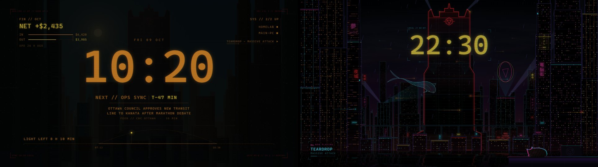
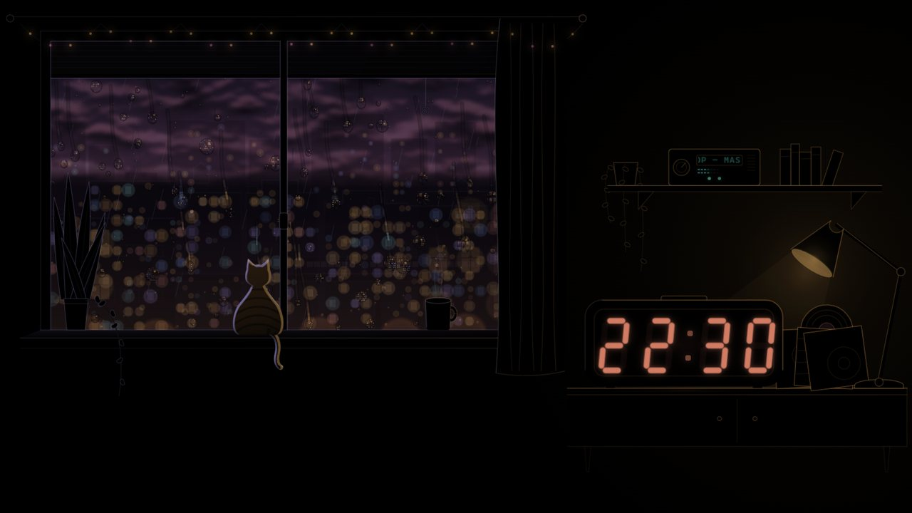
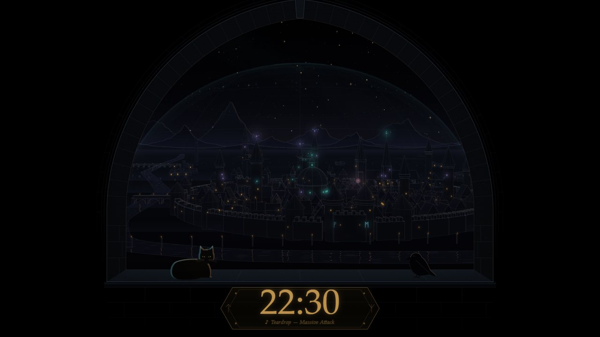
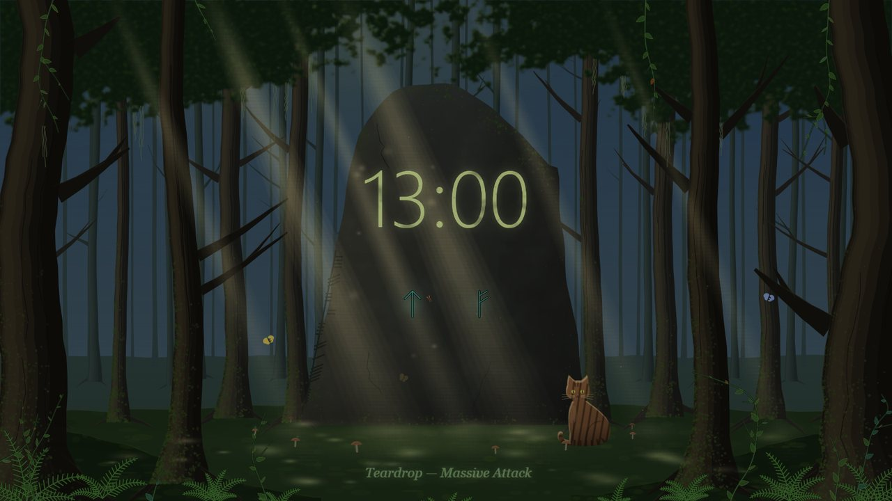
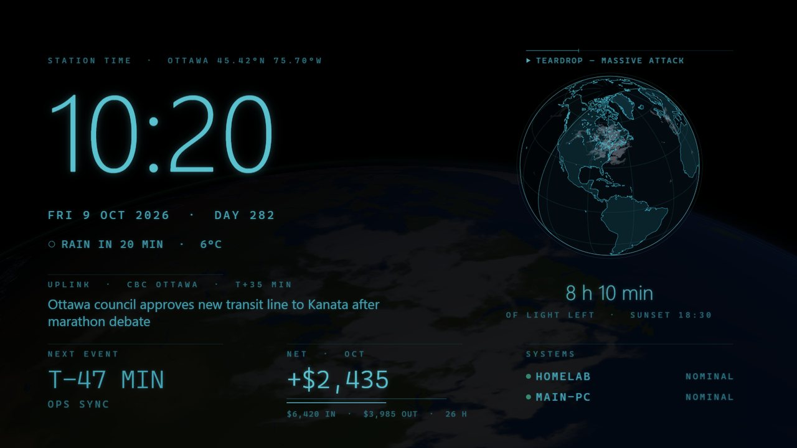

# Ambient Wall

A calm display for the wall of a home office, made for a projector. During work hours it shows the few things worth a glance: the time, the next meeting, the weather that matters, whether your machines are up, this month's money, one headline, what is playing. After hours it exhales over eight seconds and becomes a living painting that knows the real time, daylight and weather: a rainy city, a campfire burning down, a moonlit tower, a forest by day. On a projector black is invisible, so everything floats on the wall, and nothing is ever bright or white.



<sub>One theme, two faces: work (left) and ambient (right). Ten themes, real weather and daylight, an optional cat.</sub>

**Try it now:** the [online demo](https://efoders.github.io/ambient-wall/) runs in the browser on demo data.

## Quick start

1. **See it now (no install).** Open [`frontend/index.html`](frontend/index.html) in a browser: the wall runs on demo data, no server, no network. [`frontend/demo.html`](frontend/demo.html) adds a control dock (theme, cat, time of day, weather, info panels). Press `F` for full screen.
2. **Run it for real.** On any box on your network with Docker:

   ```sh
   docker compose up -d
   ```

   then open `http://<box>:8700/`. On the first visit a **setup wizard** asks for your location (city search), work schedule, theme, cat, sound and projector boost, and optional sources (news feeds, a calendar, hosts to ping, Spotify). It saves `config/config.toml` and `config/secrets.toml` and the wall starts live. See [docs/SETUP.md](docs/SETUP.md).
3. **Point the projector at it.** Open the same URL full screen on the machine that drives the projector (kiosk flags below).

Prefer files? Copy [`config/config.example.toml`](config/config.example.toml) to `config/config.toml` and edit it (every option is commented). Secrets go in `config/secrets.toml`. Both are gitignored.

**Prebuilt image.** Every push to `main` publishes a multi-arch image (amd64 and arm64, so a Raspberry Pi works) to GitHub Container Registry. Instead of building, use in `compose.yaml`:

```yaml
services:
  wall:
    image: ghcr.io/efoders/ambient-wall:latest
```

## Keys

| key | does |
|---|---|
| `F` | full screen |
| `S` | sound on / off (the first press also unlocks browser audio) |
| `+` / `-` | volume |
| `K` / `Shift+K` | the cat on / off / change its coat |
| `G` | projector boost: off, low, medium, high |
| `O` / `Esc` | show the next info panel (forecast, today, headlines, finances, projects, warnings) / dismiss it |
| `T` / `1`-`9` | next theme / pick a theme |

Choices made on the wall (sound, cat, boost) are remembered on that device. A wall with `devKeys: false` (in `frontend/js/config.js`) keeps only `S + - K G O Esc`.

<details>
<summary>Dev keys and URL parameters</summary>

| key | does |
|---|---|
| `M` | cycle mode: schedule, forced work, forced ambient |
| `[` / `]` / `0` | move the evening -/+30 min (watch the overgrowth, the fire burn down, the city lights) / reset |
| `D` | a host goes down |
| `N` | finance mood: calm, drift, warning |
| `W` | weather: overcast, clear, partly, fog, drizzle, rain, storm, snow, cold |
| `C` | calendar on / off |
| `B` | headline: top, critical, long, none |
| `P` | now playing: playing, paused, long title, none |
| `L` | live / mock (`D N W C B P` switch a live wall to mock so every state stays testable) |
| `H` | debug HUD |

URL parameters, for example `index.html?theme=nature&mode=ambient&at=2026-10-09T22:30&elapsed=19800`:

| parameter | |
|---|---|
| `theme=<id>` | `cyberpunk nature classical boreal campfire academia stainedglass lofi orbit tower` |
| `mode=work\|ambient` | force a mode |
| `at=<local ISO time>`, `warp=60`, `elapsed=<s>` | simulated clock, speed-up, seconds into the evening |
| `wx=<weather>`, `down=1`, `cal=0`, `fin=calm\|drift\|warning`, `news=<name>\|0`, `music=<name>\|0` | mock states |
| `show=<panel>&showfor=<s>` | show an info panel on load |
| `sound=1\|0`, `samples=1\|0`, `boost=0-3`, `cat=1\|0\|<coat>`, `hud=1` | sound, recordings, projector boost, cat, HUD |
| `mock=1`, `backend=host:port` | force demo data / use another backend |

</details>

## Themes

Every theme has a work face and an ambient face, real weather (rain, snow, fog, storms), a daytime and a night-time scene, its own soundscape and a place for the cat.

| theme | work face | ambient face |
|---|---|---|
| `cyberpunk` | corporate command-post HUD in amber and red | a neon megacity at night, rain, a holo whale |
| `nature` | a cleared wall in cold green, one living stem for the day | an ancient forest that overgrows the wall through the evening |
| `classical` | an instrument maker's bench in blue moonlight | a ruined temple under the real moon |
| `boreal` | a ranger station on a northern lake | the lake at night: spruce ridge, loons, aurora |
| `campfire` | a moonlit field notebook | a campfire that burns down over the evening |
| `academia` | an illuminated manuscript page | a candlelit study |
| `stainedglass` | the architect's elevation of a rose window | the window lit from behind by the real sky |
| `lofi` | a calm desk HUD | an apartment window on a rainy city night |
| `orbit` | a station telemetry console | the real Earth from a station window, the terminator in its true place |
| `tower` | an arcanist's desk | a high tower window over a moonlit city of spires |

| | |
|---|---|
|  |  |
|  |  |

All ten at a glance: [22:30](docs/images/gallery-night.jpg), [13:00](docs/images/gallery-day.jpg), [02:30](docs/images/gallery-late.jpg).

## Data sources

The backend pulls data in; nothing personal is ever sent out. One `[[source]]` table per source in `config/config.toml`; details in [docs/SOURCES.md](docs/SOURCES.md).

- **Weather**: Open-Meteo (anywhere, no key) or Environment Canada; drives the scenes and the "rain in 20 min" sliver.
- **Calendar**: any iCal URL (e.g. Google Calendar's secret iCal address); the next event and a countdown.
- **Heartbeat**: ping (ICMP or TCP) the machines you care about; a down host is the one loud flare.
- **News**: any RSS or Atom feeds, ranked, de-duplicated, with critical alerts pinned.
- **Now playing**: Spotify, Last.fm, or a push from any player.
- **Finances**: a budget Google Sheet (read-only service account).
- **Project pulse**: GitHub activity on a list of repos (ask-only panel).
- **Anything else, no code**: a JSON/CSV/TOML file, an HTTP push, any JSON API, or a script in any language. Or one Python file in `plugins/`.

With no config at all the backend runs a built-in demo source, so every element has data.

## On a projector

- **Boost:** a dim projector swallows dark tones. `G` (or `[display] boost`) lifts near-black while true black stays black.
- **Kiosk:** run Chrome or Edge full screen, with sound allowed to start on its own:

  ```sh
  msedge --kiosk http://<box>:8700/ --edge-kiosk-type=fullscreen --autoplay-policy=no-user-gesture-required
  chrome --kiosk --autoplay-policy=no-user-gesture-required http://<box>:8700/
  ```

  Without the kiosk flag, `F` goes full screen. The cursor is hidden on the wall.
- **Dark room:** the design assumes one. Everything stays under a fixed brightness budget at night and under a higher one by day, when the room is lit.

## Sound

A quiet background soundscape, never music: rain, wind, fire, birds, crickets, a city, a train, a loon on the lake, thunder when the theme's lightning flashes. Served over http (the backend, or the online demo) the wall plays real field recordings from [`frontend/sounds/`](frontend/sounds); opened from disk (`file://`) it uses procedural, synthesised voices. Off by default: `S` toggles it, `+` / `-` sets the volume, `[display] sound / volume / sound_work` sets the defaults. Credits and licences: [`frontend/sounds/CREDITS.md`](frontend/sounds/CREDITS.md).

## The cat

Every scene has a cat that sits somewhere real (a sill, a log, a cushion), lit by the scene: rim-lit by the fire, the moon or neon at night, sunlit by day. It is awake by day and early in the evening, settles into a loaf after a while and is curled up asleep by late night. `K` toggles it, `Shift+K` changes the coat (tabby, ginger, black, grey, tuxedo, calico, siamese, white). From a phone on the same network:

```sh
curl -X POST http://<box>:8700/api/command -H "Content-Type: application/json" \
     -d '{"name": "set_cat", "args": {"on": true, "coat": "ginger"}}'
```

## Development

```sh
# backend (Python 3.12+, uv)
cd backend && uv sync --all-extras && uv run pytest -q
uv run ambient                       # the server on :8700 without Docker

# frontend tests: Playwright drives the installed Microsoft Edge, about 15 min (-k <theme> for one theme)
cd frontend && uv run --with pytest --with pytest-timeout --with playwright --with pillow --with numpy pytest tests -q

# screenshots of every state of one theme, with the brightness checks
uv run --with playwright --with pillow --with numpy python frontend/tools/shoot.py --channel msedge --theme campfire

# live editing in Docker: frontend/ is served from the host, backend changes reload
docker compose -f compose.yaml -f compose.dev.yaml up --build
```

`frontend/tools/build.py` inlines everything into one self-contained `frontend/dist/ambient-wall.html`.

### Project layout

```
backend/            Python backend: adapters -> signal pool -> rules -> wall projection -> WebSocket
  ambient/adapters/   built-in source types          ambient/rules/   derived signals
  tests/              pytest suite                   Dockerfile       the image (build context = repo root)
frontend/           the wall: plain HTML + Canvas 2D, no build step, no dependencies
  index.html          the wall                       demo.html        the wall plus a control dock
  js/                 core, overlay, audio, cat      themes/          one file per theme
  sounds/             field recordings + credits     tests/, tools/   Playwright suite, shoot.py, build.py
config/             config.example.toml (yours: config.toml + secrets.toml, gitignored)
plugins/            drop-in Python adapters          scripts/         programs for command sources, helpers
docs/               SETUP, SOURCES, THEMES, ARCHITECTURE, SPEC
```

### Contributing

- **Write a theme:** [docs/THEMES.md](docs/THEMES.md) starts with a minimal working theme, then gives the full contract and design rules.
- **Add a data source:** [docs/SOURCES.md](docs/SOURCES.md) covers the no-code options and a minimal Python adapter for `plugins/`.
- **How the backend fits together:** [docs/ARCHITECTURE.md](docs/ARCHITECTURE.md). All docs: [docs/README.md](docs/README.md).
- Run the backend tests, and the frontend tests for what you touched, before opening a pull request. CI runs both.

## Licence

The code is [MIT](LICENSE). The sound recordings in [`frontend/sounds/`](frontend/sounds) keep their own licences (CC0, CC BY or CC BY-SA), listed per file with authors and sources in [`frontend/sounds/CREDITS.md`](frontend/sounds/CREDITS.md); keep that file with them when you redistribute them.
